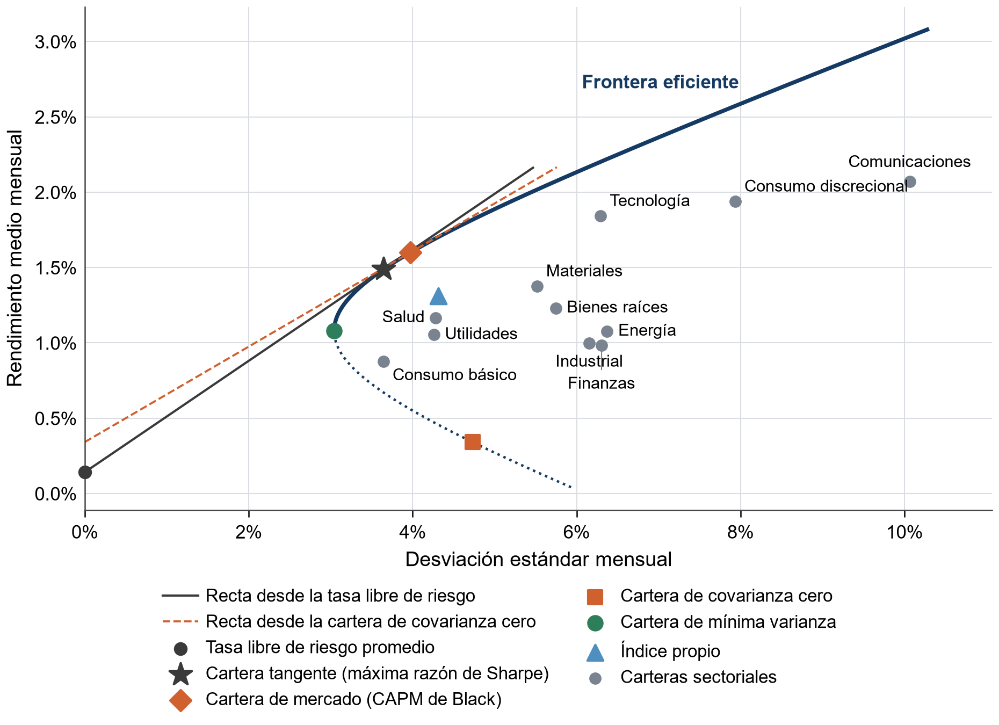

[English](README.md) | Español

# Carteras de inversión en acciones de EE. UU., 2003-2026

Joseph Aarón Atencio Arias, octubre de 2026

Este repositorio reúne los datos, el código y el informe de un análisis de carteras con 44 acciones líderes de Estados Unidos entre septiembre de 2003 y septiembre de 2026. Con ellas se construye un índice ponderado por capitalización y 11 carteras sectoriales de cuatro empresas cada una, y se estudian su diversificación, la frontera eficiente de Markowitz, el CAPM de Sharpe y de Black, las pruebas de Blume y Friend y de Gibbons, Ross y Shanken, y el costo de capital según el CAPM y según el modelo de Fama, French y Carhart.

El informe está en [`report/carteras_inversion_acciones_eeuu.pdf`](report/carteras_inversion_acciones_eeuu.pdf), con una versión en inglés en [`report/carteras_inversion_acciones_eeuu_en.pdf`](report/carteras_inversion_acciones_eeuu_en.pdf), y todo el análisis, ya ejecutado, en [`notebooks/analisis.ipynb`](notebooks/analisis.ipynb).

## Resultados principales

El índice propio creció 15.64 % por año, frente a 11.48 % del mercado de Estados Unidos (CRSP), con una razón de Sharpe mensual de 0.271 frente a 0.200. Esa ventaja no es una estrategia que se pueda repetir, porque las 44 empresas se eligieron sabiendo que hoy son líderes. Aunque el índice llega a tener 44 empresas, al cierre del período diversifica como 12.4 empresas de igual tamaño, su mínimo; el máximo fue 25.7, en septiembre de 2013.

Tecnología tiene la mejor razón de Sharpe de los 11 sectores, pero ninguno supera al índice. Las conclusiones del CAPM dependen de la referencia de mercado. Con el índice propio ningún sector tiene un alfa significativo al 5 %, y con el CRSP lo tienen cuatro. El test de Gibbons, Ross y Shanken no rechaza que el índice sea eficiente (J = 1.41, valor p de 0.168). Pasar del CAPM al modelo de Fama, French y Carhart cambia el costo de capital de un sector hasta en 3.64 puntos porcentuales, en el caso de consumo discrecional.



Frontera eficiente de las carteras sectoriales, con la cartera tangente, la cartera de mercado del CAPM de Black y el índice propio.

## Datos

Los datos son públicos y están en `data/`. Los precios mensuales ajustados y las acciones en circulación vienen de Yahoo Finance, el factor de mercado, la tasa libre de riesgo y los factores SMB, HML y de momentum vienen de la biblioteca de Kenneth French, el rendimiento del Tesoro a 20 años viene de FRED y la clasificación sectorial y el P/E esperado vienen de Finviz. [`data/README.md`](data/README.md) describe cada archivo.

El script `scripts/descargar_datos.py` vuelve a descargar todo desde las fuentes. Como Yahoo recalcula los precios ajustados y Kenneth French revisa sus factores, una descarga nueva no reproduce exactamente estos archivos, así que el análisis usa los de `data/`. Los datos pertenecen a sus proveedores y se incluyen solo para reproducir el análisis.

## Requisitos

Los resultados se generaron con Python 3.12.10 en Windows 11 y con las versiones de los paquetes que fija `requirements.txt`. El cuaderno corre en menos de un minuto en una computadora portátil y no usa números aleatorios.

## Cómo reproducir los resultados

Desde la carpeta del repositorio, primero se instalan los paquetes y luego se corre el cuaderno.

```bash
pip install -r requirements.txt
```

```bash
jupyter nbconvert --to notebook --execute --inplace notebooks/analisis.ipynb
```

El cuaderno escribe las tablas en CSV y las figuras en PNG de `outputs/`, y también escribe las cifras del texto, los cuadros y las figuras con que se compiló el informe, en la carpeta `report/latex/`, que no forma parte del repositorio. Las figuras, las cifras y los cuadros se escriben en español y en inglés, para las dos versiones del informe, y los de inglés van en las subcarpetas `en/`. Antes de exportarlos comprueba con los datos las afirmaciones del texto que no son cifras, por ejemplo que tecnología tenga la mayor razón de Sharpe, y se detiene si alguna deja de cumplirse.

## Contenido

| Ruta | Contenido |
|---|---|
| `data/` | Datos de entrada |
| `notebooks/analisis.ipynb` | Todo el análisis, ya ejecutado |
| `notebooks/herramientas_informe.py` | Funciones que dan formato de LaTeX a los cuadros y las cifras, sin calcular nada |
| `outputs/tables/` | Cada tabla calculada, en CSV y numerada en el orden del cuaderno |
| `outputs/figures/` | Las figuras del informe en PNG, y en `en/` su versión en inglés |
| `report/` | El informe en PDF, en español y en inglés |
| `scripts/descargar_datos.py` | Descarga de los datos desde sus fuentes |

## Correspondencia entre el informe y el código

| En el informe | Sección del cuaderno | Tabla en `outputs/tables/` |
|---|---|---|
| Figura 1 y cuadro 3, índice propio y CRSP | 1.1 y 1.3 | `01_indices`, `03_medidas_indices` |
| Figura 2, concentración | 1.2 | `02_concentracion` |
| Figura 3 y cuadro 2, carteras sectoriales | 1.3 | `04_medidas_sectores`, `06_indices_sectores` |
| Cuadro 4, razón de varianzas | 1.4 | `07_razon_varianzas` |
| Figura 4 y cuadros 5 a 7, frontera eficiente | 2 | `08_covarianzas` a `11_g_h` |
| Cuadros 8 a 12, CAPM de Sharpe y de Black | 3 | `12_cartera_tangente` a `16_betas_cartera_de_mercado` |
| Figuras 5 y 6 y cuadros 13 y 14, Blume y Friend y carteras cero beta | 4.1 y 4.2 | `17_blume_friend`, `18_carteras_cero_beta` |
| Test de Gibbons, Ross y Shanken | 4.3 | `19_grs` |
| Cuadro 15, modelo de Fama, French y Carhart | 5.1 | `20_cargas_ffc` |
| Figura 7 y cuadros 16 y 17, costo de capital | 5.2 | `21_primas`, `22_costo_de_capital` |
| Figura 8 y cuadro 18, crecimiento implícito | 5.3 | `23_crecimiento_implicito` |

El cuadro 1, con las empresas de cada sector, sale de `data/empresas.csv`.

## Cómo citar

Atencio Arias, J. A. (2026). *Carteras de inversión en acciones de EE. UU. Desempeño, eficiencia y costo de capital, 2003-2026*.

El archivo `CITATION.cff` tiene los mismos datos, y GitHub los muestra en otros formatos en el botón «Cite this repository».
