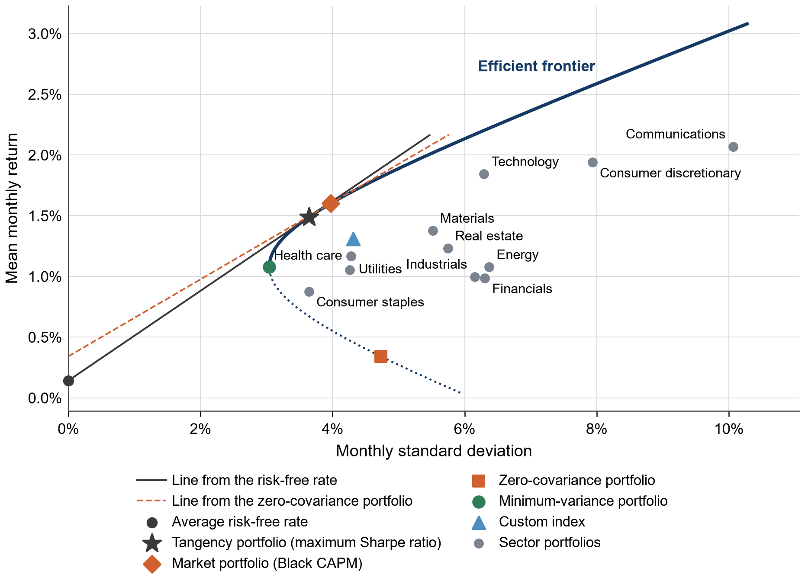

English | [Español](README.es.md)

# U.S. Equity Investment Portfolios, 2003-2026

Joseph Aarón Atencio Arias, October 2026

This repository brings together the data, code and report of a portfolio analysis of 44 leading U.S. stocks between September 2003 and September 2026. The stocks form a cap-weighted index and 11 sector portfolios of four firms each, which are used to study diversification, the Markowitz efficient frontier, the Sharpe and Black CAPM, the Blume and Friend and the Gibbons, Ross and Shanken tests, and the cost of capital under the CAPM and under the Fama, French and Carhart model.

The report is in [`report/carteras_inversion_acciones_eeuu_en.pdf`](report/carteras_inversion_acciones_eeuu_en.pdf), with the Spanish version in [`report/carteras_inversion_acciones_eeuu.pdf`](report/carteras_inversion_acciones_eeuu.pdf), and the whole analysis, already executed, is in [`notebooks/analisis.ipynb`](notebooks/analisis.ipynb). The code and its comments are in Spanish.

## Main results

The custom index grew 15.64% per year, against 11.48% for the U.S. market (CRSP), with a monthly Sharpe ratio of 0.271 against 0.200. That advantage is not a strategy that could be repeated, because the 44 firms were chosen knowing that they are leaders today. Although the index eventually holds 44 firms, at the end of the period it diversifies like 12.4 equally sized firms, its minimum; the maximum was 25.7, in September 2013.

Technology has the best Sharpe ratio of the 11 sectors, but none beats the index. The CAPM conclusions depend on the market benchmark. With the custom index no sector has a significant alpha at 5%, and with the CRSP four do. The Gibbons, Ross and Shanken test does not reject that the index is efficient (J = 1.41, p-value of 0.168). Moving from the CAPM to the Fama, French and Carhart model changes the cost of capital of a sector by up to 3.64 percentage points, in the case of consumer discretionary.



Efficient frontier of the sector portfolios, with the tangency portfolio, the market portfolio of the Black CAPM and the custom index.

## Data

The data are public and are in `data/`. Adjusted monthly prices and shares outstanding come from Yahoo Finance, the market factor, the risk-free rate and the SMB, HML and momentum factors come from Kenneth French's data library, the 20-year Treasury yield comes from FRED, and the sector classification and the forward P/E come from Finviz. [`data/README.md`](data/README.md), in Spanish, describes each file.

The script `scripts/descargar_datos.py` downloads everything again from the sources. Because Yahoo recalculates adjusted prices and Kenneth French revises his factors, a new download does not reproduce these files exactly, so the analysis uses the ones in `data/`. The data belong to their providers and are included only to reproduce the analysis.

## Requirements

The results were produced with Python 3.12.10 on Windows 11 and with the package versions pinned in `requirements.txt`. The notebook runs in less than a minute on a laptop and uses no random numbers.

## How to reproduce the results

From the repository folder, first install the packages and then run the notebook.

```bash
pip install -r requirements.txt
```

```bash
jupyter nbconvert --to notebook --execute --inplace notebooks/analisis.ipynb
```

The notebook writes the tables as CSV and the figures as PNG in `outputs/`, and it also writes the numbers in the text, the tables and the figures with which the report was compiled, in the folder `report/latex/`, which is not part of the repository. Figures, numbers and tables are written in Spanish and in English, for the two versions of the report, and the English ones go into the `en/` subfolders. Before exporting them, it checks against the data the statements in the text that are not numbers, for example that technology has the highest Sharpe ratio, and it stops if any of them no longer holds.

## Contents

| Path | Contents |
|---|---|
| `data/` | Input data |
| `notebooks/analisis.ipynb` | The whole analysis, already executed |
| `notebooks/herramientas_informe.py` | Functions that format the tables and numbers in LaTeX, without computing anything |
| `outputs/tables/` | Each computed table, as CSV and numbered in the order of the notebook |
| `outputs/figures/` | The figures of the report as PNG, and their English version in `en/` |
| `report/` | The report as PDF, in Spanish and in English |
| `scripts/descargar_datos.py` | Download of the data from their sources |

## Mapping between the report and the code

| In the report | Notebook section | Table in `outputs/tables/` |
|---|---|---|
| Figure 1 and Table 3, custom index and CRSP | 1.1 and 1.3 | `01_indices`, `03_medidas_indices` |
| Figure 2, concentration | 1.2 | `02_concentracion` |
| Figure 3 and Table 2, sector portfolios | 1.3 | `04_medidas_sectores`, `06_indices_sectores` |
| Table 4, variance ratio | 1.4 | `07_razon_varianzas` |
| Figure 4 and Tables 5 to 7, efficient frontier | 2 | `08_covarianzas` to `11_g_h` |
| Tables 8 to 12, Sharpe and Black CAPM | 3 | `12_cartera_tangente` to `16_betas_cartera_de_mercado` |
| Figures 5 and 6 and Tables 13 and 14, Blume and Friend and zero-beta portfolios | 4.1 and 4.2 | `17_blume_friend`, `18_carteras_cero_beta` |
| Gibbons, Ross and Shanken test | 4.3 | `19_grs` |
| Table 15, Fama, French and Carhart model | 5.1 | `20_cargas_ffc` |
| Figure 7 and Tables 16 and 17, cost of capital | 5.2 | `21_primas`, `22_costo_de_capital` |
| Figure 8 and Table 18, implied growth | 5.3 | `23_crecimiento_implicito` |

Table 1, with the firms in each sector, comes from `data/empresas.csv`.

## How to cite

Atencio Arias, J. A. (2026). *U.S. equity investment portfolios. Performance, efficiency and cost of capital, 2003-2026*.

The `CITATION.cff` file has the same reference for the Spanish version, and GitHub shows it in other formats under the "Cite this repository" button.
